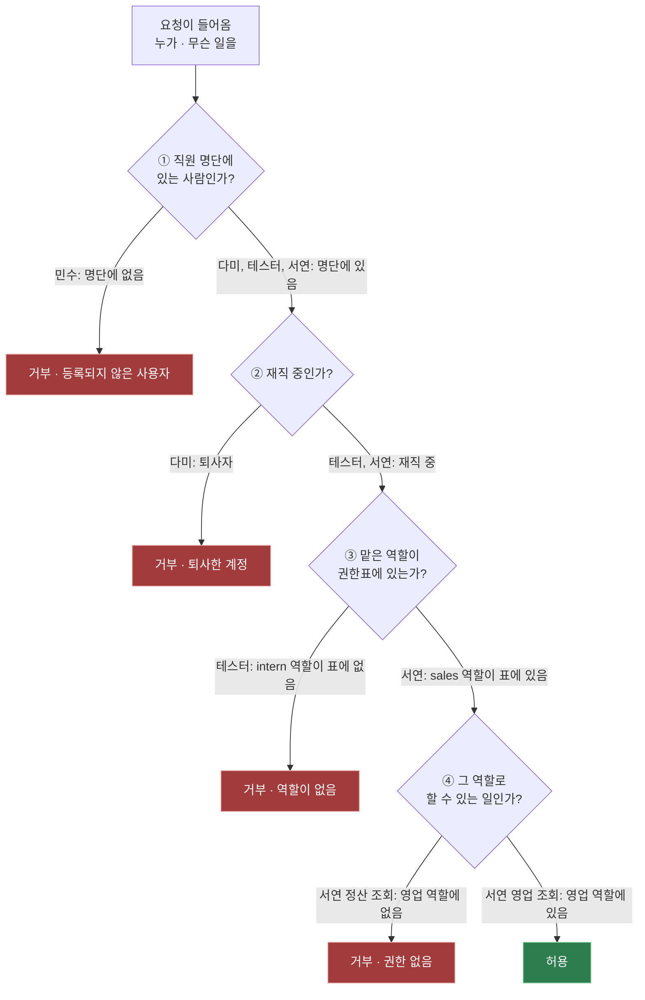
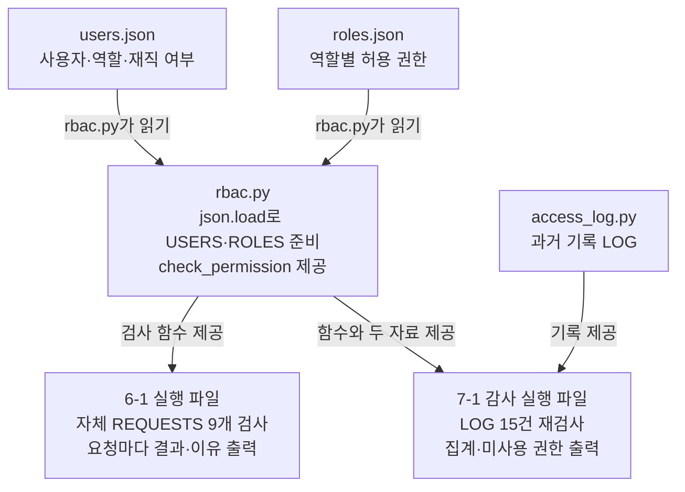
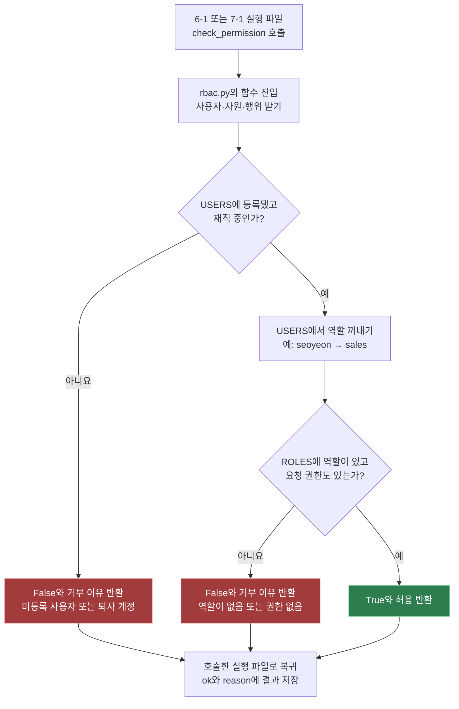
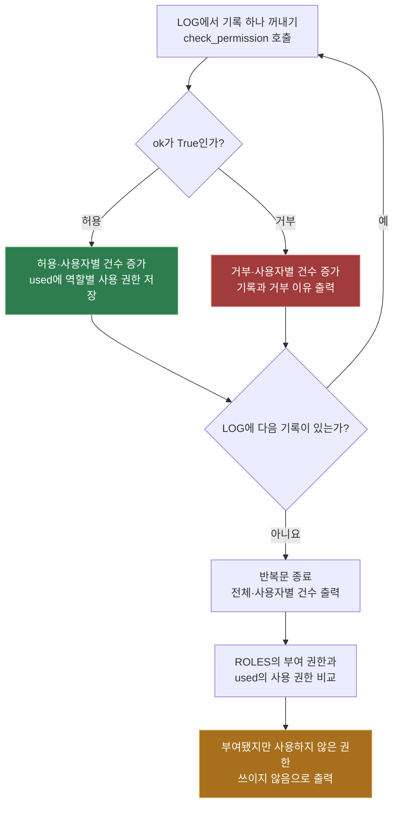

# 10/21 · 요청 검사와 접근 기록 감사
> **지금 하는 일:** “이 사람이 이 일을 해도 될까?”를 역할별 권한표로 확인하는 실습이다.
>
> 먼저 예시 요청을 하나씩 검사하고(6-1), 이어서 같은 검사 도구로 과거 접근 기록을 살펴본다(7-1). 감사에서는 거부된 요청과 사용자별 건수를 확인하고, 부여됐지만 사용하지 않은 권한도 찾는다. 두 실행 파일은 각각 따로 실행한다.
>
> **핵심 흐름:** 사용자·권한표 준비 → 요청을 검사 함수에 전달 → 허용·거부와 이유 반환 → 실행 파일이 출력·집계

## 1. 두 실행 파일은 무엇이 다른가?

두 파일 모두 **rbac.py의 같은 검사 함수**를 사용하지만, 검사할 자료와 결과 활용 방법이 다르다.
두 실행 파일이 차례로 서로를 실행하는 구조는 아니다. 각각 따로 실행한다.

| 구분 | day01_6-1_run.py | day01_7-1_audit_run.py |
|---|---|---|
| 목적 | 권한 검사 함수가 어떻게 판단하는지 확인 | 과거 접근 기록을 재검사하고 감사 결과 집계 |
| 검사 자료 | 실행 파일 안의 `REQUESTS` 9개 | `access_log.py`의 `LOG` 15건 |
| 함수에 전달 | 사용자·자원·행위 | 사용자·자원·행위 |
| 출력 | 모든 요청의 허용 여부와 이유 | 거부 상세, 전체·사용자별 건수, 미사용 권한 |

## 2. 공통 준비: JSON 자료가 검사 기준이 되는 과정

두 실행 파일은 `from functions.rbac import ...`로 rbac.py를 불러온다.
이때 **rbac.py가 JSON을 열어 읽는다.** JSON 자체가 실행되거나 다른 파일로 이동하는 것은 아니다.

| 읽는 파일 | rbac.py에서 하는 작업 | 만들어지는 값과 용도 |
|---|---|---|
| `config/roles.json` | `open`으로 열고 `json.load`로 읽기 | `ROLES`: 역할마다 가능한 권한 목록 |
| `config/users.json` | `open`으로 열고 `json.load`로 읽기 | `USERS`: 사용자마다 역할·재직 여부 |

예를 들어 `USERS`는 **seoyeon이 sales 역할**이라는 것을 알려주고, `ROLES`는 **sales가 영업 조회·변경만 가능**하다는 것을 알려준다.
`check_permission`은 준비된 두 값을 이용해 요청을 검사한다. 함수는 호출할 때 동작한다.

## 3. day01_6-1_run.py: 요청 하나씩 검사해 보기

이 파일은 `access_log.py`를 읽지 않는다. 자기 안에 준비된 `REQUESTS` 목록을 사용한다.

```python
for user, resource, action in REQUESTS:
    ok, reason = check_permission(user, resource, action)
    print(user, resource, action, "->", ok, reason)
```

1. `REQUESTS`에서 요청 하나를 꺼내 사용자·자원·행위로 나눈다.
2. 세 값을 `check_permission`에 전달한다.
3. 함수가 돌려준 허용 여부를 `ok`, 이유를 `reason`에 담는다.
4. 결과를 출력하고, 다음 요청에도 같은 일을 반복한다.

현재 자료 기준 예상 결과는 다음과 같다. 실행 확인 출력은 아니다.

| 사용자 | 요청 | 결과 | 이유 |
|---|---|---|---|
| seoyeon | SALES:QUERY | True | 허용 |
| seoyeon | SETTLE:QUERY | False | 권한 없음 |
| junho | SETTLE:QUERY | True | 허용 |
| junho | SALES:CHANGE | False | 권한 없음 |
| dami | SALES:QUERY | False | 퇴사한 계정 |
| minsu | SALES:QUERY | False | 등록되지 않은 사용자 |
| gaeun | ACCOUNT:CHANGE | True | 허용 |
| batch-night | SETTLE:QUERY | True | 허용 |
| tester | SALES:QUERY | False | 역할이 없음 |

예를 들어 seoyeon의 정산 조회는 **사용자가 없어서가 아니라, sales 역할에 정산 조회 권한이 없어서** 거부된다.

## 4. rbac.py: 두 실행 파일이 함께 쓰는 검사 방법

검사는 아래 순서로 진행하며, 하나라도 실패하면 그 자리에서 함수가 끝난다.

1. `USERS`에 사용자 이름이 있는가? → 없으면 `등록되지 않은 사용자`
2. 그 사용자의 `employed`가 참인가? → 아니면 `퇴사한 계정`
3. 사용자의 `role`을 꺼냈을 때 `ROLES`에 있는가? → 없으면 `역할이 없음`
4. `자원:행위`를 만들어 해당 역할의 권한 목록에서 찾을 수 있는가? → 없으면 `권한 없음`
5. 모두 통과하면 `(True, "허용")` 반환

예: `SETTLE`과 `QUERY`를 합쳐 `SETTLE:QUERY`라는 글자로 검사한다.
현재 함수는 시각·기기·접속 위치를 검사하지 않는다.

## 5. day01_7-1_audit_run.py: 과거 기록을 검사하고 모아 보기

이 파일은 `config.access_log`에서 `LOG`를 가져온다. 기록 하나에는 번호와 시각도 들어 있다.

```python
for log_id, time, user, resource, action in LOG:
    ok, reason = check_permission(user, resource, action)
```

검사 방법은 6-1과 같지만, 받은 결과를 아래처럼 활용한다.

| 결과 | 실행 파일의 처리 |
|---|---|
| 허용 | `allowed` 증가, `counts`에 사용자별 허용 집계, `used`에 역할별 사용 권한 저장 |
| 거부 | `denied` 증가, `counts`에 사용자별 거부 집계, 번호·시각·요청·거부 이유 출력 |
| 모든 기록 처리 후 | 전체·사용자별 건수 출력, `ROLES`와 `used` 비교 |

**미사용 권한 = 역할에 부여된 권한 중 이번 허용 기록에서 사용되지 않은 권한**이다.
예를 들어 sales에는 조회와 변경 권한이 있지만 허용 기록에서 조회만 했다면, 변경 권한을 `쓰이지 않음`으로 출력한다.
사용 기록이 없는 역할은 `used.get(role, [])`로 빈 목록을 사용한다.

현재 자료 기준 예상 집계는 **허용 7건·거부 8건**이다. 거부는 모두 seoyeon의 정산 조회다.
과거 기록을 현재 기준으로 재판정하는 것이므로 당시 차단 여부를 증명하지 않는다.
또한 미사용 권한은 검토 후보이며, 프로그램이 권한을 삭제하지 않는다.

## 6. 실행 방법

자료 경로가 터미널의 현재 위치를 기준으로 되어 있으므로 `code_review`에서 각각 실행한다.

```bash
python -m run.day01_6-1_run
python -m run.day01_7-1_audit_run
```

## 7. 그림으로 연결해서 보기

하나의 긴 그림 대신 **전체 관계 → 공통 검사 → 감사 결과 처리**로 나눴다.
그림 1에서 연결을 보고, 자세한 동작이 궁금하면 다음 그림으로 내려가면 된다.

### 먼저 보기 · 건물 출입으로 보는 권한 검사

`check_permission`을 건물 출입 확인에 빗댄 그림이다. 파일 이름은 잊고, **한 사람을 골라 그 이름이 적힌 화살표만 따라가며** 읽는다.
네 질문은 모두 `rbac.py`가 위에서부터 차례로 확인하고, 하나라도 걸리면 그 자리에서 거부한다. 상자를 누르면 해당 코드가 열린다.



| 사람 | 요청 | 지나는 길 | 결과 |
|---|---|---|---|
| 민수 (minsu) | 영업 조회 | ① | 거부 · 등록되지 않은 사용자 |
| 다미 (dami) | 영업 조회 | ① → ② | 거부 · 퇴사한 계정 |
| 테스터 (tester) | 영업 조회 | ① → ② → ③ | 거부 · 역할이 없음 |
| 서연 (seoyeon) | 정산 조회 | ① → ② → ③ → ④ | 거부 · 권한 없음 |
| 서연 (seoyeon) | 영업 조회 | ① → ② → ③ → ④ | 허용 |

### 그림 1 · 자료와 두 실행 파일의 연결

JSON을 읽는 주체는 가운데의 rbac.py이다. 두 실행 파일은 같은 함수를 각자 호출한다.




### 그림 2 · functions/rbac.py 안에서 작동하는 권한 검사

**작동 위치: `functions/rbac.py`의 `check_permission` 함수 내부.** 6-1 또는 7-1 실행 파일이 함수를 호출하면 아래 검사가 시작된다. 검사가 끝나면 호출했던 실행 파일의 `ok, reason`으로 결과가 돌아간다. 실패하면 즉시 반환한다.




그림에서는 질문을 두 묶음으로 줄였다. 실제 코드는 본문 4절의 네 검사를 순서대로 진행한다.

### 그림 3 · run/day01_7-1_audit_run.py 안에서 작동하는 집계

**작동 위치: `run/day01_7-1_audit_run.py` 내부.** 그림 2의 함수가 돌려준 `ok, reason`을 받아 집계한다. 이 작업은 7-1에만 있고, 6-1은 결과를 한 줄씩 출력하는 것으로 끝난다. 거부된 요청은 사용 권한에 넣지 않는다.




