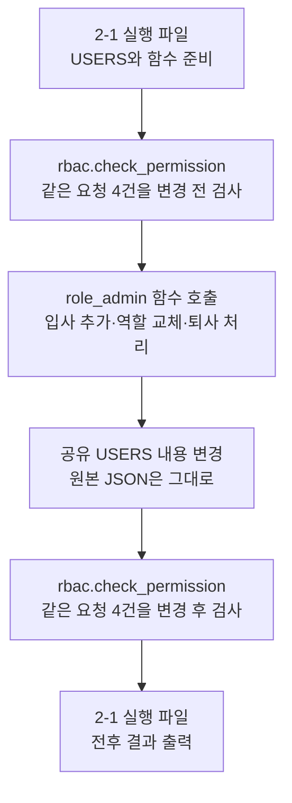
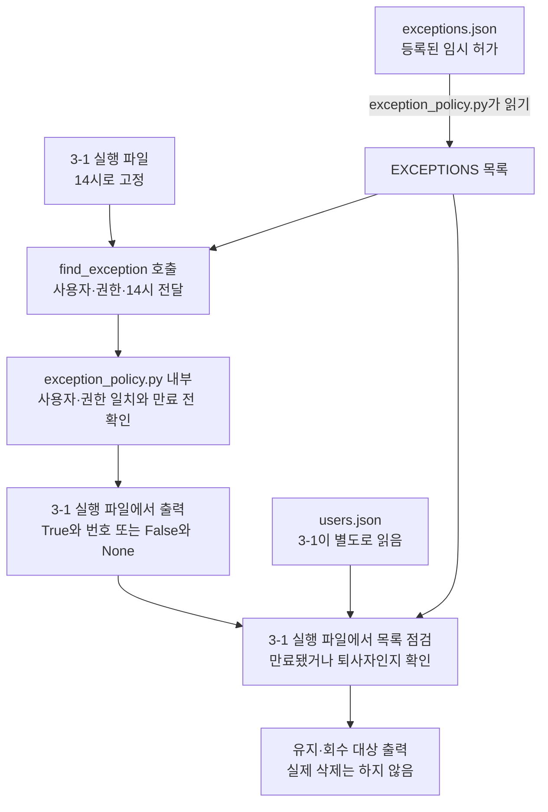
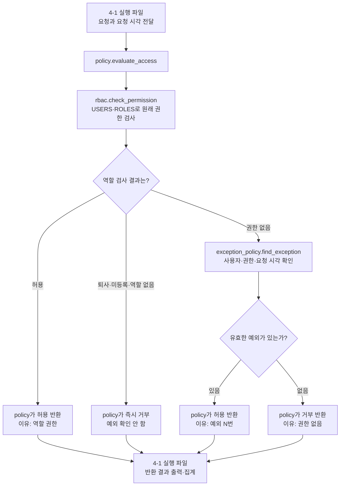
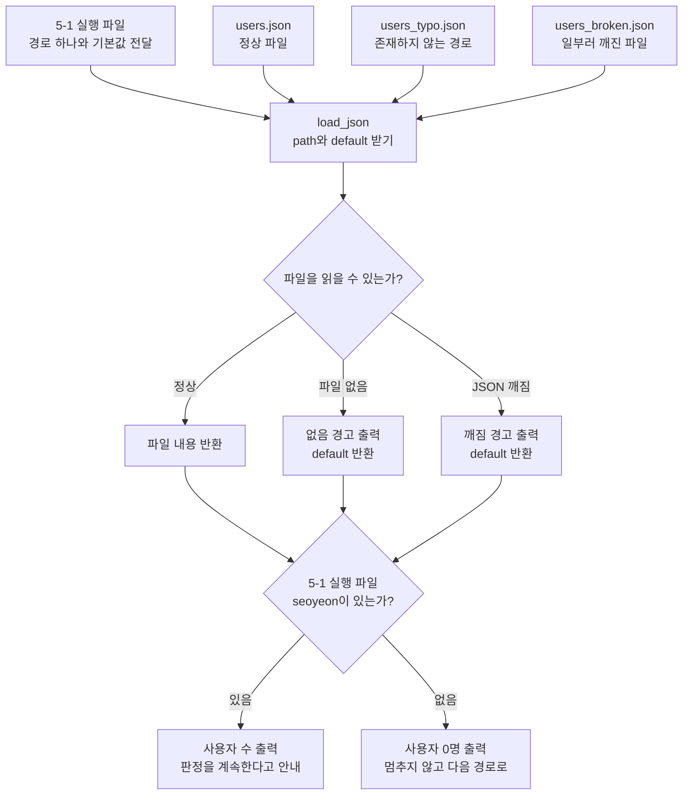
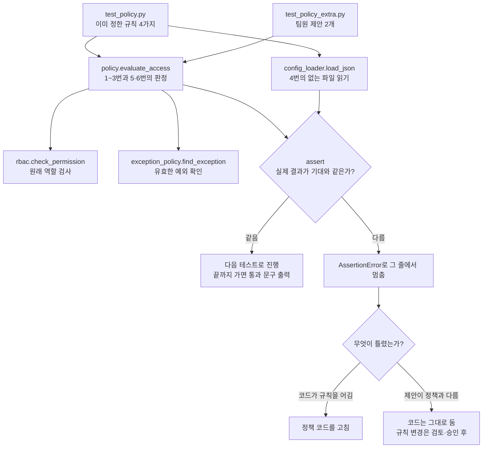

# 10/22 · 사용자 변경과 임시 허가를 최종 접근 판단에 연결하기

> **지금 하는 일:** “입사·이동·퇴사하면 권한을 어떻게 바꿀까?”, “원래 권한이 없어도 잠깐 허용하려면?”, “둘을 합쳐 안전하게 판단하려면?”, “설정 파일이 고장 나면?”, “규칙이 계속 지켜지는지 어떻게 확인할까?”를 차례로 실습한다.
>
> **2-1은 명단 변경**, **3-1은 임시 허가 확인**, **4-1은 최종 접근 판단**, **5-1은 안전한 설정 읽기**, **6-1은 규칙 테스트**다. 실행 파일은 각각 따로 실행하며, 앞 실행의 메모리 변경이 다음 실행에 자동으로 이어지지 않는다.

## 1. 파일마다 질문 하나로 기억하기

| 파일·함수 | 맡은 질문 | 사용하는 자료 |
|---|---|---|
| `rbac.py` · `check_permission` | 원래 역할로 이 일을 할 수 있어? | users.json, roles.json |
| `role_admin.py` · `assign_role`, `revoke_access` | 입사·이동·퇴사를 명단에 반영할까? | 전달받은 USERS, ROLES |
| `exception_policy.py` · `find_exception` | 이 사람에게 아직 유효한 임시 허가가 있어? | exceptions.json |
| `policy.py` · `evaluate_access` | 역할 검사와 임시 허가를 합치면 최종 결과는? | 위 검사 함수 두 개 |
| `config_loader.py` · `load_json` | 설정 파일이 없거나 깨져도 멈추지 않고 읽으려면? | 전달받은 경로의 JSON 파일 |
| `test_policy.py` | 꼭 지켜야 할 규칙이 지금도 지켜지는가? | `evaluate_access`, `load_json` |
| `test_policy_extra.py` | 팀원이 제안한 규칙이 지금 정책과 맞는가? | `evaluate_access` |

[10/21 문서](10-21_day01.md)에서 만든 역할 검사는 그대로 재사용한다. 사용자 등록·재직 여부·역할·권한을 검사하는 상세 순서는 해당 문서를 참고한다.

## 2. 자료와 실행 파일은 어떻게 연결되나?

설정 파일은 스스로 동작하지 않는다. 파이썬 파일이 열어 읽고, 함수가 그 값을 사용한다.

- `rbac.py`가 users.json과 roles.json을 읽어 `USERS`, `ROLES`에 담는다.
- `exception_policy.py`가 exceptions.json을 읽어 `EXCEPTIONS`에 담는다.
- 실행 파일은 요청 목록에서 값을 꺼내 함수에 전달하고, 반환된 결과를 출력한다.

예를 들어 `(False, "권한 없음")`을 반환하면 아래처럼 두 변수에 나눠 담는다.

```python
ok, reason = check_permission(user, resource, action)
# ok: False / reason: "권한 없음"
```

함수를 불러오는 `import`와 실제 일을 시키는 `함수이름(...)` 호출은 다르다.

## 3. 2-1 · 사용자 명단을 바꾸고 같은 요청을 다시 검사

**실행 파일: `run/day02_2-1_run.py`**

먼저 CHECKS의 요청 4개를 기존 `check_permission`으로 검사한다. 이어 인사 변경을 처리하고, 같은 요청을 다시 검사한다.

| 처리 | 호출하는 함수 | 명단에서 바뀌는 내용 |
|---|---|---|
| minsu 입사 | `assign_role(USERS, "minsu", "sales")` | 새 항목 추가, 영업 역할·재직 True |
| seoyeon 이동 | `assign_role(USERS, "seoyeon", "finance")` | 기존 역할을 재무로 교체 |
| junho 퇴사 | `revoke_access(USERS, "junho")` | 역할은 남기고 재직 False |

`assign_role`은 존재하는 역할인지 먼저 확인한다. 오타인 `salse`로 hana를 등록하려 하면 거부하고 명단도 바꾸지 않는다.
`revoke_access`는 명단에 없는 ghost를 회수하려 하면 거부한다.

### 왜 변경한 명단으로 다시 검사되는가?

실행 파일의 `USERS`, 함수가 받은 `users`, rbac.py의 `USERS`는 같은 딕셔너리를 가리킨다.
`users[name] = ...`로 그 안을 바꾸므로 기존 검사 함수도 변경된 내용을 본다.
파일 저장 코드는 없으므로 원본 users.json은 바뀌지 않는다.

| 요청 | 변경 전 | 변경 후 |
|---|---|---|
| minsu 영업 조회 | 미등록으로 거부 | 허용 |
| seoyeon 영업 변경 | 허용 | 권한 없음으로 거부 |
| seoyeon 정산 조회 | 거부 | 허용 |
| junho 정산 조회 | 허용 | 퇴사한 계정으로 거부 |

`(True, "회수")`는 퇴사 처리가 성공했다는 뜻이며, 요청을 허용한다는 뜻은 아니다.

## 4. 3-1 · 임시 허가가 아직 유효한지 확인

**실행 파일: `run/day02_3-1_run.py` / 검사 함수: `functions/exception_policy.py`의 `find_exception`**

exceptions.json은 이미 등록된 임시 허가 목록이다. 함수를 호출한다고 새 허가가 만들어지지는 않는다.

```json
{"id": 1, "user": "seoyeon", "permission": "SETTLE:QUERY", "expires": "2026-10-22 18:00", "reason": "월말 정산 대조 지원"}
```

이 항목은 “seoyeon에게 정산 조회를 10월 22일 18시 전까지 특별히 허용”한다는 뜻이다.
`reason`은 등록 사유이며, 함수는 사용자·권한·만료 시각으로 유효 여부를 판단한다.

```python
find_exception(user, permission, now)
```

1. `EXCEPTIONS`에서 항목을 하나씩 꺼낸다.
2. 사용자와 `자원:행위`가 모두 같은지 확인한다.
3. expires의 글자를 `datetime.strptime`로 시간 값으로 바꾼다.
4. `now < expires`이면 `(True, 예외 번호)`를 반환한다.
5. 끝까지 유효한 항목을 못 찾으면 `(False, None)`을 반환한다.

18시 만료라면 17:59는 유효하고, 18:00부터는 만료다.
`now`는 컴퓨터 현재 시각을 자동으로 가져온 값이 아니라 **호출한 쪽에서 전달한 시각**이다.

### 실행 파일이 하는 두 가지 작업

- **1단계:** 고정 시각 `2026-10-22 14:00`으로 요청 6개에 유효한 예외가 있는지 확인한다.
- **2단계:** users.json도 별도로 읽어 만료된 예외와 퇴사자 예외를 회수 대상으로 출력한다. 실제 삭제는 하지 않는다.

| 번호 | 사용자 | 14시 기준 점검 결과 |
|---|---|---|
| 1 | seoyeon | 18시 전이므로 유지 |
| 2 | junho | 이미 만료되어 회수 대상 |
| 3 | dami | 기간은 남았지만 퇴사자이므로 회수 대상 |
| 4 | batch-night | 다음 날 09시 전이므로 유지 |
| 5 | gaeun | 12시에 만료되어 회수 대상 |

**주의할 차이:** `find_exception` 자체는 재직 여부를 검사하지 않는다. 따라서 dami도 `(True, 3)`을 받을 수 있다. 이것은 “유효기간이 남은 예외가 있다”는 뜻이며 최종 접근 허용은 아니다.

## 5. 4-1 · 두 검사를 합쳐 최종 접근 판단

**실행 파일: `run/day02_4-1_run.py` / 최종 함수: `functions/policy.py`의 `evaluate_access`**

policy.py는 같은 검사를 새로 만들지 않고 기존 두 함수에 순서대로 일을 맡긴다.

| 순서 | 코드의 의미 | 결과 |
|---|---|---|
| 1 | `check_permission`으로 원래 권한 검사 | 허용 여부와 거부 이유를 받음 |
| 2 | 원래 권한으로 허용됨 | `(True, "역할 권한")`으로 종료 |
| 3 | 거부 이유가 `권한 없음`이 아님 | 퇴사·미등록·없는 역할이면 즉시 거부 |
| 4 | 해당 업무 권한만 부족함 | `find_exception`으로 임시 허가 확인 |
| 5 | 유효한 임시 허가가 있음 | `(True, "예외 N번")`으로 종료 |
| 6 | 임시 허가도 없음 | `(False, "권한 없음")` 반환 |

핵심 코드는 다음이다.

```python
if reason != "권한 없음":
    return False, reason
```

“정상적인 사용자지만 해당 업무 권한만 부족한 경우”에만 예외를 확인한다.
이 줄이 없으면 퇴사자 dami가 남아 있는 예외로 허용될 수 있다.

### 요청 하나를 따라가기

seoyeon이 16:20에 정산 조회를 요청한다고 해보자.

1. 실행 파일이 `evaluate_access("seoyeon", "SETTLE", "QUERY", now)`를 호출한다.
2. policy가 rbac에 물으면 영업 역할이라 `False, "권한 없음"`이 나온다.
3. policy가 예외 함수에 `"seoyeon", "SETTLE:QUERY", now`를 전달한다.
4. 예외 1번의 만료 시각인 18시 전이므로 `True, 1`이 나온다.
5. policy가 `True, "예외 1번"`을 반환한다.
6. 실행 파일이 출력하고 예외 허용·예외 1번 사용 횟수를 늘린다.

18:05에 같은 요청이 오면 예외가 만료되어 거부된다.

### 실행 파일이 출력하고 세는 것

TODAY_LOG의 요청 9건마다 날짜와 요청 시각을 합쳐 `now`를 만들고 최종 함수에 전달한다.
역할 허용·예외 허용·거부를 counts에, 예외 번호별 사용 횟수를 used에 센다.
권한 없음으로 거부됐는데 동일 사용자·권한의 예외 항목이 남아 있으면 `[만료 뒤 시도]`도 출력한다.

현재 자료 기준 예상 결과이며, 이번 문서 작성 중 실행으로 확인한 출력은 아니다.

| 집계 | 예상값 |
|---|---|
| 역할로 허용 | 1건: junho 정산 조회 |
| 예외로 허용 | 4건 |
| 거부 | 4건 |
| 예외 사용 | 1번 2회, 5번 1회, 4번 1회 |
| 만료 뒤 시도 | gaeun 12:30, junho 15:00, seoyeon 18:05 |

**왜 junho가 여기서는 허용될까?** 2-1은 실행 중 메모리에서만 퇴사 처리했다.
4-1을 새로 실행하면 원본 users.json을 다시 읽으므로 junho는 다시 원본의 재직 상태로 검사된다.
role_admin.py가 4-1에서 자동으로 호출되는 것도 아니다.

## 6. 5-1 · 설정 파일이 고장 나도 멈추지 않게 읽기

**실행 파일: `run/day02_5-1_broken.py` / 읽기 함수: `functions/config_loader.py`의 `load_json`**

`open`과 `json.load`만 쓰면 파일이 없거나 내용이 깨졌을 때 오류가 나면서 프로그램이 멈춘다.
`load_json`은 이 두 오류를 받아 경고를 출력하고, 미리 받아 둔 기본값을 대신 돌려준다.

```python
def load_json(path, default):
    try:
        with open(path, encoding="utf-8") as f:
            return json.load(f)
    except FileNotFoundError:
        print("[경고] 설정 파일 없음:", path)
        return default
    except json.JSONDecodeError:
        print("[경고] 설정 파일 깨짐:", path)
        return default
```

### 매개변수 `default`와 `return default`의 관계

둘은 다른 기능이 아니라 같은 값을 받아서 쓰는 앞뒤 과정이다.

1. 호출할 때 `load_json(path, {})`처럼 넘긴 `{}`가 매개변수 `default`에 담긴다. 이때는 아직 아무것도 반환하지 않는다.
2. 파일을 읽어 본다. 성공하면 파일 내용을 반환하고 `default`는 쓰이지 않는다.
3. 실패하면 `return default`가 실행되어 받아 둔 `{}`를 돌려준다.

함수 안에 `return {}`로 고정하지 않고 값을 받는 이유는 호출하는 쪽이 실패 시 받을 값을 정하게 하기 위해서다.
딕셔너리가 필요한 곳은 `{}`, 리스트가 필요한 곳은 `[]`를 넘기면 된다.

### 실행 파일이 시험하는 세 경로

실행 파일은 경로 3개를 차례로 `load_json(path, {})`에 넘기고, 받은 값에 `seoyeon`이 있는지로 결과를 나눠 출력한다.

| 경로 | 상황 | `load_json`의 처리 | 실행 파일의 출력 |
|---|---|---|---|
| `config/users.json` | 정상 파일 | 파일 내용 반환 | 사용자 6명을 읽음 |
| `config/users_typo.json` | 파일 없음 | `FileNotFoundError` → 경고 후 `{}` 반환 | 사용자 0명 |
| `config/users_broken.json` | JSON 깨짐 | `JSONDecodeError` → 경고 후 `{}` 반환 | 사용자 0명 |

users_broken.json은 일부러 깨 놓은 실습 자료다. 마지막 항목 뒤의 쉼표가 JSON 문법 오류이므로 고치면 안 된다.

```json
{
  "seoyeon": {"role": "sales", "employed": true},
}
```

실제 실행 결과는 다음과 같다. `[경고]`는 오류가 아니라 `load_json`이 일부러 출력한 메시지다.

```
config/users.json -> 사용자 6 명을 읽음, 판정을 계속한다
[경고] 설정 파일 없음: config/users_typo.json
config/users_typo.json -> 사용자 0 명, 등록된 사용자가 없다
[경고] 설정 파일 깨짐: config/users_broken.json
config/users_broken.json -> 사용자 0 명, 등록된 사용자가 없다
```

**주의할 차이:** 현재 `rbac.py`와 `exception_policy.py`는 `load_json`을 쓰지 않고 `open`으로 직접 읽는다. 따라서 `load_json`의 보호는 이 함수를 직접 호출하는 5-1과 테스트 4번에만 적용되고, users.json이 깨지면 rbac.py를 불러오는 단계에서 오류가 나며 멈춘다.

## 7. 6-1 · 지켜야 할 규칙을 테스트로 확인

**테스트 파일: `functions/test_policy.py`, `functions/test_policy_extra.py`**

테스트 파일은 새 기능을 담은 파일이 아니라, 지금까지 만든 기능을 불러와 제대로 동작하는지 확인하는 **점검표**다.
접근 요청과 기대하는 판정을 한 쌍으로 적어 두고, 실제 결과와 비교한다.

```python
ok, reason = evaluate_access("seoyeon", "SETTLE", "QUERY", at("2026-10-22 18:00"))   # 실제 기능 실행
assert ok == False, "3-2. 만료 정각 거부"                                               # 기대와 비교
```

`assert`는 뒤의 조건이 참이면 그냥 지나가고, 거짓이면 `AssertionError`를 내며 그 줄에서 멈춘다. 쉼표 뒤의 글자는 실패할 때 보여 줄 설명이다.
`at`은 `"2026-10-22 14:00"` 같은 글자를 시간 값으로 바꾸는 작은 함수다.

### 두 테스트 파일의 차이

| | `test_policy.py` | `test_policy_extra.py` |
|---|---|---|
| 확인하는 것 | 이미 정한 규칙 4가지 | 팀원의 새 제안 2개 (5·6번) |
| 기대 결과 | 모두 통과해야 함 | 실패할 수 있음 |
| 실패의 의미 | 코드가 망가졌을 가능성이 큼 | 코드가 틀렸는지 제안이 정책과 다른지 판단해야 함 |
| 작성 | 2~4번을 직접 작성 | 주어진 코드를 그대로 사용 |

### `test_policy.py` · 꼭 지켜야 할 규칙 4가지

| 번호 | 요청 | 기대 결과 | 규칙이 있는 곳 |
|---|---|---|---|
| 1 | junho 정산 조회, 14:00 | 허용, 이유 `역할 권한` | roles.json, `rbac.py`, `policy.py` |
| 2 | seoyeon 계정 변경, 14:00 | 거부, 이유 `권한 없음` | roles.json, `policy.py` |
| 3-1 | seoyeon 정산 조회, 17:59 | 허용, 이유 `예외 1번` | exceptions.json, `exception_policy.py` |
| 3-2 | seoyeon 정산 조회, 18:00 | 거부 | `exception_policy.py`의 `now < expires` |
| 4 | 없는 파일 `config/no_such.json` 읽기 | `seoyeon`이 들어 있지 않음 | `config_loader.py` |

1~3번은 `evaluate_access`를 통해 전체 판정 흐름을 시험하고, 4번은 `load_json`을 직접 시험한다.
모두 통과하면 마지막 줄까지 실행되어 다음처럼 출력된다.

```
[경고] 설정 파일 없음: config/no_such.json
테스트 4개 모두 통과
```

테스트가 있으면 코드를 고치다 생긴 실수를 바로 알 수 있다. 예를 들어 누군가 `now < expires`를 `now <= expires`로 바꾸면 만료 정각에도 접근이 허용되는데, 이때 3-2번에서 멈춘다.

### `test_policy_extra.py` · 팀원의 제안 시험

| 번호 | 팀원의 제안 | 결과 | 판단 |
|---|---|---|---|
| 5 | 퇴사자 dami는 예외가 남아 있어도 거부 | 통과 | 현재 정책과 같음 |
| 6 | seoyeon은 만료 정각 18:00에도 허용 | **실패** | 제안이 현재 정책과 다름 |

5번은 `policy.py`의 `if reason != "권한 없음":`이 예외를 보기 전에 퇴사자를 돌려보내므로 통과한다.
6번은 현재 정책이 `now < expires`라서 18:00을 거부하므로 실패한다. `test_policy.py`의 3-2번과 정반대 결과를 요구하는 제안이다.

```
5 통과
Traceback (most recent call last):
  ...
  File "...\functions\test_policy_extra.py", line 14, in <module>     ← 14번째 줄에서 멈춤
    assert ok == True, "6. 만료 정각에도 허용되어야 한다(팀원 제안)"     ← 멈춘 assert
AssertionError: 6. 만료 정각에도 허용되어야 한다(팀원 제안)              ← assert에 적어 둔 설명
```

이 실패는 고쳐야 할 오류가 아니라 **이 파일에서 나와야 하는 결과**다. 14번째 줄에서 멈추므로 `6 통과`도 출력되지 않는다.
테스트가 실패하면 먼저 “코드가 틀렸는가, 제안이 정책과 다른가”를 판단한다. 6번을 받아들이려면 코드를 고치기 전에 만료 규칙 변경에 대한 검토와 승인이 필요하다. 이 교시에서는 코드를 고치지 않고 판단만 한다.

## 8. 실행 방법과 현재 코드 확인

터미널을 `code_review`에 두고 각각 실행한다.

```bash
python -m run.day02_2-1_run
python -m run.day02_3-1_run
python -m run.day02_4-1_run
python -m run.day02_5-1_broken
python -m functions.test_policy
python -m functions.test_policy_extra
```

현재 세 함수 파일의 주요 로직과 `functions.…` import 연결은 자료의 의도와 맞는다.
policy.py의 `find_exception(user, (f"{resource}:{action}"), now)`에서 문자열을 감싼 추가 괄호는 있어도 동작에 문제가 없다.

`-m` 뒤에는 파일 경로가 아니라 모듈 이름을 쓰므로 `.py`를 붙이지 않고 폴더는 `.`으로 구분한다.
`python -m run.day02_5-1_broken.py`처럼 `.py`를 붙이면 코드는 실행되지만 마지막에 `Error while finding module specification` 오류가 함께 나온다.
파일이 `run` 폴더 밖에 있으면 `No module named` 오류가 난다.

아래 세 명령은 이 내용을 정리하면서 다시 실행해 확인했다.

| 명령 | 결과 |
|---|---|
| `python -m run.day02_5-1_broken` | 정상 파일 1개를 읽고 고장 난 경로 2개는 경고 후 계속 진행 |
| `python -m functions.test_policy` | `테스트 4개 모두 통과` |
| `python -m functions.test_policy_extra` | `5 통과` 후 6번에서 의도된 `AssertionError` |

## 9. 그림으로 흐름 보기

### 그림 1 · 2-1 실행: 사용자 명단 변경과 전후 비교

작동 위치는 **run/day02_2-1_run.py**이다. 명단 변경만 role_admin.py에 맡기고, 전후 검사는 rbac.py에 맡긴다.




### 그림 2 · 3-1 실행: 임시 허가 확인과 목록 점검

작동 위치는 **run/day02_3-1_run.py**이다. 유효기간 확인과 재직 여부 점검이 서로 다른 작업임을 구분해서 본다.




### 그림 3 · 4-1 실행: 최종 판단에서 함수들이 연결되는 순서

시작과 출력은 **run/day02_4-1_run.py**, 가운데 결정은 **functions/policy.py**에서 작동한다.
rbac와 예외 함수는 각각의 파일에서 검사한 뒤 policy로 결과를 돌려준다.




### 그림 4 · 5-1 실행: 고장 난 설정 파일을 안전하게 읽기

시작과 출력은 **run/day02_5-1_broken.py**, 읽기와 오류 처리는 **functions/config_loader.py**에서 작동한다.
경로 3개마다 아래 흐름을 한 번씩 반복한다.




### 그림 5 · 6-1 실행: 테스트가 기능을 불러와 확인하는 순서

테스트 파일은 판정을 직접 하지 않는다. 기존 함수를 호출하고, 돌아온 결과를 `assert`로 기대와 비교한다.




